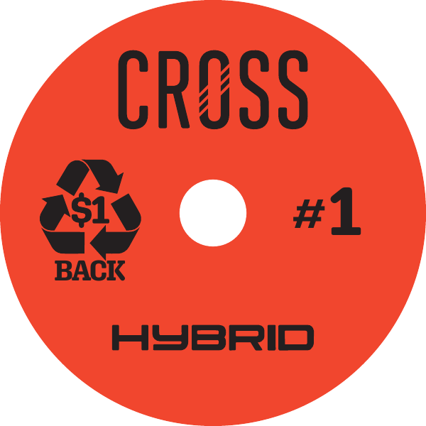
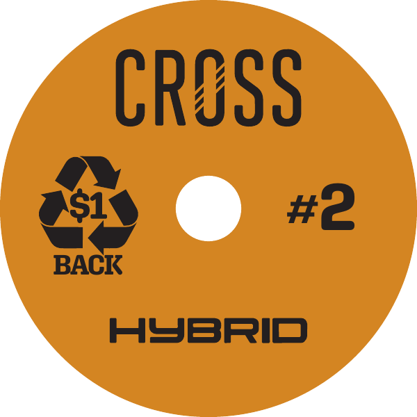
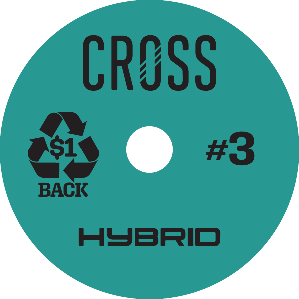

# CR-4 — Pads Cross (arte final aprovada)

Card no Jira: [CR-4](https://vaztech.atlassian.net/browse/CR-4)

**Modelo escolhido pelo cliente.** Arte final recebida em 08/10/2026 para envio ao fornecedor.

- Arquivo: [`Patch_4pol.pdf`](Patch_4pol.pdf). Gerado no Adobe Illustrator 30.5, com 3 páginas.
- Formato: 4 × 4 polegadas (288 × 288 pt), disco de 4″ com furo central.
- Linha **HYBRID**, sequência de 3 passos:

| Página | Passo | Cor | Prévia |
| --- | --- | --- | --- |
| 1 | #1 | Vermelho |  |
| 2 | #2 | Laranja |  |
| 3 | #3 | Verde-azulado |  |

Elementos comuns às três páginas: logotipo CROSS, selo de reciclagem "$1 BACK", número do passo e "HYBRID".

## Verificação técnica do PDF

- Cor: CMYK (DeviceCMYK). Não há RGB.
- Fontes incorporadas: Parabolica Bold e Aglet Slab Bold.
- Sangria: não há. BleedBox = TrimBox = 288 × 288 pt. Confirmar com o fornecedor se ele precisa de sangria ou de linha de corte (faca).

## Pendências para o envio

- Confirmar com o fornecedor o formato de arquivo, a sangria/faca e o processo de impressão.
- O selo **"$1 BACK"** é uma promessa pública ao comprador. Antes da produção em escala, as regras do programa de devolução e reciclagem precisam estar definidas: quem paga, como devolver, prazo e canais. Ver item 10 do documento `CR-2-posicionamento/01-leitura-critica-briefing.md`.
