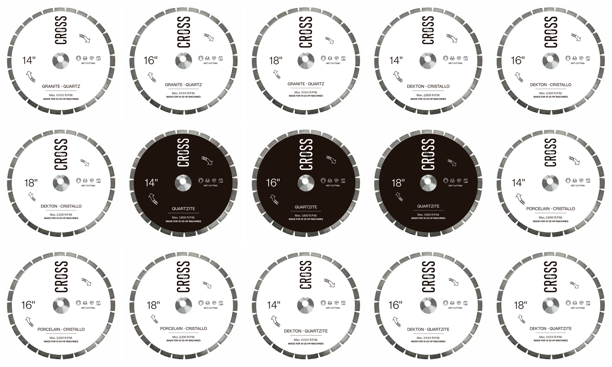

# CR-9: blades Cross, layout definitivo aprovado para produção

Card no Jira: [CR-9](https://vaztech.atlassian.net/browse/CR-9). Envio ao fornecedor: [CR-22](https://vaztech.atlassian.net/browse/CR-22). RPM: [CR-16](https://vaztech.atlassian.net/browse/CR-16).

As 15 artes foram recebidas em 17/11/2026: 5 linhas, cada uma em 14″, 16″ e 18″. Todas para corte úmido ("WET CUTTING") e "MADE FOR 10-25 HP MACHINES".

| Linha (nome do arquivo) | Material impresso | Fundo | 14″ | 16″ | 18″ | Pronta para produção? |
| --- | --- | --- | --- | --- | --- | --- |
| Granite-Quartz | GRANITE - QUARTZ | Branco | XXXX | XXXX | XXXX | **Não, falta o RPM** |
| Hercules | DEKTON - CRISTALLO | Branco | 2,600 | 2,500 | 2,200 | Sim |
| Queen | QUARTZITE | Preto | 1,900 | 1,800 | 1,600 | Sim |
| Safety | PORCELAIN - CRISTALLO | Branco | 2,600 | 2,500 | 2,200 | Sim |
| The King Quartzite | DEKTON - QUARTZITE | Branco | XXXX | XXXX | XXXX | **Não, falta o RPM** |

Os valores são o RPM máximo impresso ("Max. ___ R.P.M.").

## Verificação técnica dos PDFs

- Gerados no Adobe Illustrator 30.5, com 1 página cada.
- Fontes incorporadas: família Parabolica (Regular, Medium, Bold, Light).
- **Cor: RGB** (perfil ICC de 3 canais). Não há CMYK. A arte das pads (CR-4) veio em CMYK. Confirmar com o fornecedor se ele aceita RGB ou se é preciso converter.
- Prancheta: 14″ = 1121,77 × 1113,5 pt · 16″ = 1267,51 × 1258,16 pt · 18″ = 1432,51 × 1421,95 pt.

## Observações

- O erro "Max. 4,5000 R.P.M." das artes antigas não aparece mais. Os nomes "Silent Core/Slim Blade" também saíram.
- Os nomes das linhas (Hercules, Queen, Safety, The King) aparecem só no nome do arquivo, não na arte.
- Hercules e Safety têm o mesmo layout e os mesmos RPM; a diferença é o material impresso (Dekton × Porcelain, ambos com Cristallo).
- A fonte dos valores de RPM (ficha técnica do fornecedor) ainda precisa ser registrada no CR-16.
